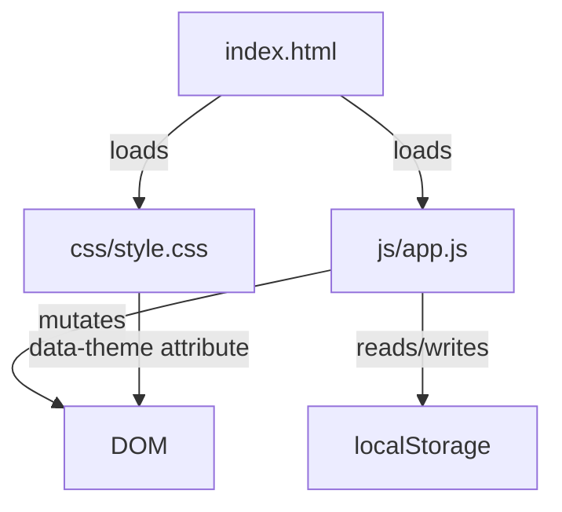

# Design Document

## Overview

The Life Dashboard is a single-page, client-side web application that runs directly in the browser with no build step, no package manager, and no external runtime dependencies. All application code is split across exactly three files:

- `index.html` — markup and semantic structure
- `css/style.css` — all visual styling
- `js/app.js` — all runtime logic

The page is loaded by opening `index.html` directly in a browser or serving it from any static file server. There is no server-side component; all persistence is handled via the browser's `localStorage` API.

---

## Architecture



The HTML file defines the structure and loads the stylesheet in `<head>` and the script at the end of `<body>`. The script runs after the DOM is fully parsed. All user-generated data flows through `localStorage` for persistence across page reloads.

---

## Components and Interfaces

### File Structure

#### `index.html`

The HTML file establishes the full DOM tree:

- `<html lang="en" data-theme="dark">` — the theme-switching root; the `data-theme` attribute is toggled between `"dark"` and `"light"` by JavaScript, which activates the corresponding CSS variable block.
- `<header class="topbar">` — the sticky top bar, divided into three child divs:
  - `.topbar-left` — contains `#greeting-text` (time-of-day salutation), `#user-name` (the clickable display name), and `#edit-name-btn` (pencil icon button).
  - `.topbar-center` — contains `#clock` (live `HH:MM:SS` display) and `#date-display` (full date string).
  - `.topbar-right` — contains `#theme-toggle` (sun/moon icon button).
- `#name-modal` — a hidden overlay (`class="modal hidden"`) that wraps `.modal-box` containing a text input (`#name-input`), a Save button (`#name-save-btn`), and a Cancel button (`#name-cancel-btn`). Shown when the user wants to change their display name.
- `<main class="dashboard">` — the CSS Grid container holding three card sections:
  - `section.card.timer-card` — Focus Timer: `#timer-display`, Start/Stop/Reset buttons, duration input (`#timer-duration`), Set button (`#timer-set`), and `#timer-status`.
  - `section.card.todo-card` — To-Do List: task text input (`#todo-input`), Add button (`#todo-add-btn`), `<ul id="todo-list">`, and empty-state hint (`#todo-empty`).
  - `section.card.links-card` — Quick Links: label input (`#link-name-input`), URL input (`#link-url-input`), Add button (`#link-add-btn`), `#links-grid` (the chip container), and empty-state hint (`#links-empty`).
- `#edit-modal` — a second hidden overlay for editing an existing task, containing `#edit-input`, a Save button (`#edit-save-btn`), and a Cancel button (`#edit-cancel-btn`).

#### `css/style.css`

All styling. No external CSS framework is used.

#### `js/app.js`

All runtime logic. No external JavaScript libraries are used.

---

## CSS Architecture

### Design Tokens

CSS custom properties are declared on `:root` and represent the light-theme palette. Every component consumes these tokens rather than hard-coded colour values:

| Token | Purpose |
|---|---|
| `--bg` | Page background |
| `--bg-card` | Card and topbar surface |
| `--bg-input` | Input field and chip background |
| `--border` | All border and divider colours |
| `--text` | Primary text colour |
| `--text-muted` | Secondary / placeholder text |
| `--accent` | Primary interactive colour (purple) |
| `--accent-hover` | Hovered accent |
| `--danger` | Destructive-action colour (red) |
| `--danger-hover` | Hovered danger |
| `--success` | Success state (green, used for running timer) |
| `--warning` | Secondary button colour (amber) |
| `--shadow` | Box-shadow value |
| `--radius` | Standard border radius (`14px`) |
| `--radius-sm` | Small border radius (`8px`) |
| `--transition` | Standard transition shorthand (`.18s ease`) |
| `--font` | Font stack (`'Segoe UI', system-ui, …`) |

### Dark Theme Override

The `[data-theme="dark"]` selector overrides only the palette tokens (`--bg`, `--bg-card`, `--bg-input`, `--border`, `--text`, `--text-muted`, `--shadow`). All other tokens are inherited from `:root`, so layout, spacing, and accent colours are identical between themes.

### Smooth Theme Switching

`body` carries `transition: background var(--transition), color var(--transition)`, which animates the background and text colour whenever `data-theme` changes.

### Topbar

`.topbar` uses `position: sticky; top: 0; z-index: 100` so it remains visible during page scroll. It is a flex row with `justify-content: space-between` and `flex-wrap: wrap` for small viewports.

### Dashboard Grid

`.dashboard` is a `display: grid` container with:

```css
grid-template-columns: repeat(auto-fit, minmax(320px, 1fr));
max-width: 1200px;
margin: 0 auto;
```

This produces a multi-column layout on wide viewports that reflows automatically to a single column as the viewport narrows below the 320 px column minimum.

### Timer State Classes

The `#timer-display` element receives CSS classes to reflect the timer's state:

- `.running` — sets `color: var(--success)` (green) while the countdown is active.
- `.finished` — sets `color: var(--danger)` (red) when the countdown reaches zero.
- Neither class present — default `color: var(--accent)` (purple) at rest.

### Modal Pattern

Both modals share the same structure:

- `position: fixed; inset: 0` — covers the full viewport.
- `background: rgba(0,0,0,.55)` — semi-transparent backdrop.
- `backdrop-filter: blur(3px)` — frosted-glass effect behind the modal box.
- Visibility is controlled by toggling the `.hidden` class, which sets `display: none`.

### Modal Animations

When a modal becomes visible, two `@keyframes` run on its children:

- `fadeIn` — the backdrop fades from `opacity: 0` to `opacity: 1` in 150 ms.
- `slideUp` — the `.modal-box` translates from `translateY(20px)` with `opacity: 0` to its resting position in 180 ms.

### Responsive Media Query

A single `@media (max-width: 600px)` block reduces:

- Topbar padding from `0.9rem 2rem` to `0.8rem 1rem`.
- `#clock` font size from `2rem` to `1.5rem`.
- `.timer-display` font size from `3.5rem` to `2.6rem`.
- `.dashboard` padding from `2rem` to `1rem` and gap from `1.5rem` to `1rem`.

---

## Data Models

All data is persisted in `localStorage` using `JSON.stringify` on write and `JSON.parse` on read. The five keys and their shapes are:

| Key | Type | Description |
|---|---|---|
| `dashboard_name` | `string` | The user's display name. Default: `"Friend"`. |
| `dashboard_theme` | `boolean` | `true` = dark theme, `false` = light theme. Default: `true`. |
| `timer_duration` | `number` | Focus timer duration in minutes (1–120). Default: `25`. |
| `dashboard_tasks` | `Array<{ id: number, text: string, done: boolean }>` | The ordered task list. Default: `[]`. |
| `dashboard_links` | `Array<{ id: number, name: string, url: string }>` | The ordered links list. Default: `[]`. |

Task and link `id` values are set to `Date.now()` at creation, giving each item a unique numeric identifier.

---

## JavaScript Architecture

`app.js` is a single script with no module system. It is organised into six logical sections, each handling one feature area, plus a set of shared helpers at the top.

### Helpers

```js
const $  = (sel) => document.querySelector(sel);
const $$ = (sel) => document.querySelectorAll(sel);
function getLS(key, fallback) { … }  // JSON.parse with try/catch
function setLS(key, value)    { … }  // JSON.stringify
```

`getLS` returns the fallback value if the key is absent or if `JSON.parse` throws.

### Clock & Greeting Module

`tickClock()` reads `new Date()` and updates three DOM elements:

- `#clock` — formatted as `HH:MM:SS` (zero-padded).
- `#greeting-text` — determined by looking up the current hour in a `GREETINGS` array of `{ range: [start, end], text }` objects.
- `#date-display` — formatted as `{DayName}, {DayNumber} {MonthName} {FullYear}`.

`tickClock()` is called once immediately on script execution (so the display is correct before the first interval fires), then scheduled via `setInterval(tickClock, 1000)`.

### Custom Name Module

State: `userName` (string, loaded from `dashboard_name` on startup, defaulting to `"Friend"`).

Functions:

- `renderName()` — sets `#user-name.textContent` to `userName`.
- `openNameModal()` — pre-fills `#name-input` (empty when name is `"Friend"`, otherwise the current name), removes `.hidden` from `#name-modal`, and focuses the input after 50 ms.

Event listeners:

- `#edit-name-btn` click → `openNameModal()`
- `#user-name` click → `openNameModal()`
- `#name-save-btn` click — trims input; if non-empty, updates `userName`, writes to `dashboard_name`, calls `renderName()`, closes modal.
- `#name-cancel-btn` click → adds `.hidden` to `#name-modal`.
- `#name-modal` click (backdrop) → adds `.hidden` if `e.target` is the modal overlay itself.

### Theme Module

State: `isDark` (boolean, loaded from `dashboard_theme`, defaulting to `true`).

`applyTheme()` sets `document.documentElement.dataset.theme` to `"dark"` or `"light"` and updates `#theme-toggle` emoji (`🌙` or `☀️`).

`applyTheme()` is called once on startup, then on each `#theme-toggle` click which also flips `isDark` and writes the new value to `dashboard_theme`.

### Focus Timer Module

State variables:

| Variable | Type | Description |
|---|---|---|
| `timerDuration` | `number` | Active duration in minutes (from `timer_duration`). |
| `timerRemaining` | `number` | Seconds remaining in the current countdown. |
| `timerInterval` | `number \| null` | The `setInterval` handle, or `null` when stopped. |
| `timerRunning` | `boolean` | Whether the countdown is actively ticking. |

Functions:

- `formatTime(secs)` — returns `"MM:SS"` string with zero-padding.
- `renderTimer()` — sets `#timer-display.textContent` via `formatTime(timerRemaining)`.
- `setTimerState(state)` — removes both `.running` and `.finished` classes from `#timer-display`, then adds the given class string if non-null.
- `applyTimerDuration()` — parses `#timer-duration`, validates range 1–120, updates `timerDuration` and `timerRemaining`, stops any running interval, writes to `timer_duration`, re-renders.

Event listeners:

- `#timer-start` click — guards against `timerRunning` or `timerRemaining === 0`; sets `timerRunning = true`, calls `setTimerState("running")`, starts `setInterval` decrementing `timerRemaining` each second.
- `#timer-stop` click — guards against `!timerRunning`; clears interval, sets `timerRunning = false`, calls `setTimerState(null)`.
- `#timer-reset` click — clears interval, restores `timerRemaining = timerDuration * 60`, re-renders, calls `setTimerState(null)`.
- `#timer-set` click and `#timer-duration` Enter keydown → `applyTimerDuration()`.
- A one-time `{ once: true }` listener on `#timer-start` requests `Notification.permission` on the first Start click if permission is `"default"`.

When `timerRemaining` reaches zero inside the interval callback: the interval is cleared, `timerRunning = false`, `setTimerState("finished")` is called, the status text is set, and a desktop notification is fired if `Notification.permission === "granted"`.

### To-Do List Module

State: `tasks` (array loaded from `dashboard_tasks`), `editingTaskId` (number or null — tracks which task the Edit Modal is currently editing).

Functions:

- `saveTasks()` — calls `setLS("dashboard_tasks", tasks)`.
- `escapeHTML(str)` — replaces `&`, `<`, `>`, `"`, `'` with their HTML entities to prevent XSS when inserting task text into `innerHTML`.
- `renderTasks()` — clears `#todo-list`, iterates `tasks`, builds `<li class="todo-item">` elements using `escapeHTML` on task text, appends to list; toggles the empty-state hint.
- `addTask()` — trims `#todo-input`; if non-empty, pushes `{ id: Date.now(), text, done: false }`, calls `saveTasks()`, `renderTasks()`, clears input.
- `openEditModal(task)` — sets `editingTaskId`, populates `#edit-input`, removes `.hidden` from `#edit-modal`, focuses input after 50 ms.
- `saveEdit()` — trims `#edit-input`; if non-empty, updates the matching task's text, calls `saveTasks()`, `renderTasks()`, closes modal.

**Event delegation on `#todo-list`:** A single `click` listener calls `e.target.closest(".todo-item")` to find the row, then checks `e.target.classList` to dispatch to the correct handler:

- `.task-check` → toggles `task.done`, saves, re-renders.
- `.edit-btn` → calls `openEditModal`.
- `.delete-btn` → filters the task from the array, saves, re-renders.

### Quick Links Module

State: `links` (array loaded from `dashboard_links`).

Functions:

- `saveLinks()` — calls `setLS("dashboard_links", links)`.
- `renderLinks()` — clears `#links-grid`, builds `<a class="link-chip">` elements with `target="_blank" rel="noopener noreferrer"`, appends to grid; toggles the empty-state hint.
- `addLink()` — trims both inputs; if non-empty, prepends `https://` if the URL lacks an `http(s)://` prefix, pushes `{ id: Date.now(), name, url }`, saves, re-renders, clears inputs.

**Event delegation on `#links-grid`:** A single `click` listener calls `e.target.closest(".link-remove")`. If matched, `e.preventDefault()` stops navigation, the link is filtered from the array, saved, and re-rendered.

### Global Keyboard Handler

```js
document.addEventListener("keydown", (e) => {
  if (e.key === "Escape") {
    $("#edit-modal").classList.add("hidden");
    $("#name-modal").classList.add("hidden");
    editingTaskId = null;
  }
});
```

This single listener closes both modals unconditionally on Escape, regardless of which is open.

### Event Delegation Pattern

Both the task list and the links grid manage dynamic content (items added and removed at runtime). Rather than attaching and removing individual listeners per item, each parent container (`#todo-list` and `#links-grid`) carries a single `click` listener. The handler walks up the event target chain with `e.target.closest()` or checks `e.target.classList` to identify the action, then dispatches to the appropriate logic. This avoids listener leaks when items are removed and keeps the event-wiring code proportional to the number of container elements rather than the number of items.

---

## Correctness Properties

*A property is a characteristic or behavior that should hold true across all valid executions of a system — essentially, a formal statement about what the system should do. Properties serve as the bridge between human-readable specifications and machine-verifiable correctness guarantees.*

### Property 1: Task array persistence round-trip

*For any* tasks array state and any single mutation (add, toggle `done`, edit text, or delete), immediately after the mutation `JSON.parse(localStorage.getItem("dashboard_tasks"))` must deep-equal the live in-memory `tasks` array.

**Validates: Requirements 13.4**

### Property 2: Links array persistence round-trip

*For any* links array state and any single mutation (add or remove), immediately after the mutation `JSON.parse(localStorage.getItem("dashboard_links"))` must deep-equal the live in-memory `links` array.

**Validates: Requirements 13.5**

### Property 3: Timer duration set resets remaining time

*For any* integer duration `d` in the range [1, 120], after `applyTimerDuration` completes with that value: `timerRemaining` equals `d * 60`, `timerRunning` is `false`, and `localStorage` key `timer_duration` holds `d`.

**Validates: Requirements 5.4**

### Property 4: Countdown decrements by exactly one per tick

*For any* starting `timerRemaining` value greater than zero, after `N` countdown ticks have fired, `timerRemaining` equals `initialRemaining - N`.

**Validates: Requirements 6.1**

### Property 5: Start is idempotent while running

*For any* timer state where `timerRunning` is already `true` or `timerRemaining` is `0`, clicking the Start button leaves both `timerRunning` and `timerRemaining` unchanged.

**Validates: Requirements 6.3**

---

## Error Handling

All `localStorage` reads are wrapped in a `try/catch` inside `getLS`. If `JSON.parse` throws (for example, because a stored value is corrupted), the function returns the provided fallback value. The stored entry is not overwritten — the fallback is used only for the in-memory state of the current session.

Invalid timer duration input (non-numeric or outside 1–120) is caught in `applyTimerDuration`, which displays a status message and leaves all timer state unchanged.

Empty or whitespace-only task text and empty link fields are silently ignored; no error is displayed for these cases.

---

## Testing Strategy

This feature is a vanilla JavaScript browser application with direct DOM manipulation. The core logic separates into two layers:

**Pure-function layer** (suitable for unit and property-based tests in a Node.js or jsdom environment):

- `getGreeting(hour)` — deterministic mapping of hour to greeting string.
- `formatTime(secs)` — deterministic formatting function.
- `escapeHTML(str)` — deterministic string transformation.
- `getLS` / `setLS` — wrappers around `JSON.parse` / `JSON.stringify`.

**DOM-integrated layer** (suitable for browser-based integration tests or a jsdom harness):

- Clock tick loop, task CRUD operations, link CRUD operations, timer state machine, theme toggle, name modal, edit modal.

**Unit tests** should cover:

- `getGreeting` at each hour-range boundary (0, 5, 12, 18, 22, 23).
- `formatTime` at zero, one second, 59 seconds, 60 seconds, and 3599 seconds.
- `escapeHTML` with each of the five replaced characters (`&`, `<`, `>`, `"`, `'`) and combinations.
- `getLS` returning the fallback when the stored value is absent or malformed.

**Property-based tests** (using a library such as [fast-check](https://github.com/dubzzz/fast-check)) should implement each Correctness Property above, running a minimum of 100 iterations per property:

- **Property 1** — generate arbitrary task arrays and mutations; assert localStorage round-trip equality.
  - *Tag: Feature: life-dashboard, Property 1: task array persistence round-trip*
- **Property 2** — generate arbitrary links arrays and mutations; assert localStorage round-trip equality.
  - *Tag: Feature: life-dashboard, Property 2: links array persistence round-trip*
- **Property 3** — generate integers in [1, 120]; assert timer state after `applyTimerDuration`.
  - *Tag: Feature: life-dashboard, Property 3: timer duration set resets remaining time*
- **Property 4** — generate starting remaining values and tick counts; assert countdown decrement.
  - *Tag: Feature: life-dashboard, Property 4: countdown decrements by exactly one per tick*
- **Property 5** — generate running/zero states; assert Start click idempotence.
  - *Tag: Feature: life-dashboard, Property 5: Start is idempotent while running*

**Integration / example-based tests** should cover:

- Timer completion: start at 1 second, advance clock, verify `timerRunning === false`, `.finished` class present, status text correct.
- Theme toggle: click toggles `data-theme` attribute and icon, persists to `localStorage`.
- Modal dismiss paths: Escape key, Cancel button, and backdrop click each close the correct modal without side effects.
- Empty-state display: task list and links grid each show and hide the empty-state hint correctly.
